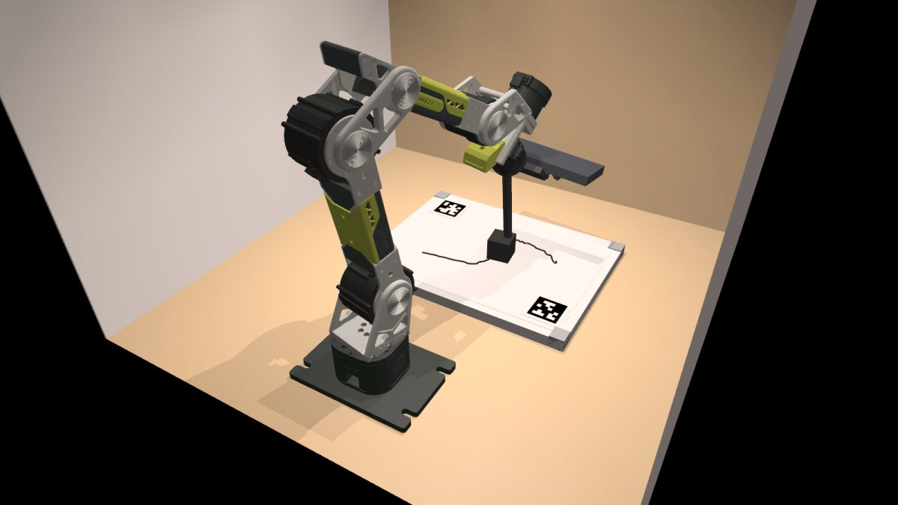
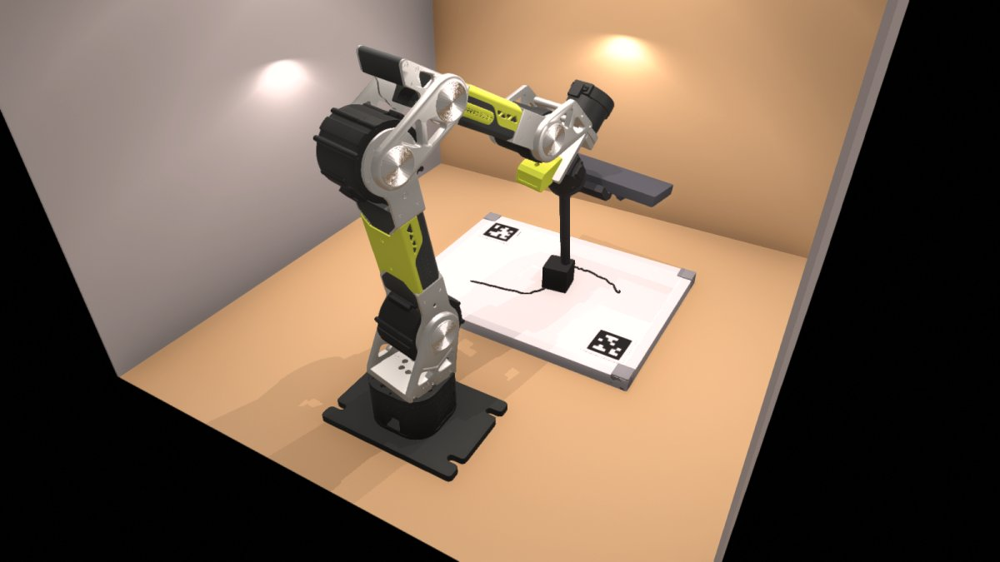

# The twin scene

`sim/twin.py` is a second, more complete scene of the setup. It draws the arm with the meshes of the manufacturer and the pusher with its printed mesh, closes the photo box on all six sides, and has lights and a camera tone that were tuned to pictures of the real cameras. The loose objects on the table are a list that you can change. The first scene, [`sim/scene.py`](simulation.md), stays as it is, and the tools in `robot/` use the first scene with `--sim`.





## Use it

```bash
uv sync --group robot --python 3.12
uv run python sim/fetch_arm_meshes.py                 # once: download the arm meshes (about 30 MB)
uv run python sim/twin.py render --out /tmp/twin      # both camera views, default object poses
uv run python sim/twin_view.py                        # interactive viewer (needs a display)
```

From code:

```python
import sys

sys.path.insert(0, 'sim')
import twin

cfg = twin.load_config()
with twin.make_arm(cfg) as arm:  # a rebot_control.Arm on the simulator, as in the first scene
    arm.backend.set_q(q)  # or arm.enable(); arm.move_home(); ...
    image = twin.render(arm, 'top')  # 'wrist' is the camera on the tool; scale=0.5 gives a smaller picture
    twin.set_object_pose(arm, 'cube', 0.35, 0.05, 30.0)  # x, y (m) and yaw (deg) of a loose object
```

Rendering needs a GL context. Set `MUJOCO_GL` as for [the first scene](simulation.md#the-gl-backend): `egl` on Linux without a display, `glfw` on macOS.

### The arm meshes

The meshes of the arm are not in this repository. `sim/fetch_arm_meshes.py` downloads them from [Seeed-Projects/reBot-DevArm](https://github.com/Seeed-Projects/reBot-DevArm) at a fixed commit, with the licence text (CERN-OHL-W-2.0), and checks each file against `sim/assets/meshes/b601_rs_official/SHA256SUMS`. A file that does not match is not kept.

| Command | Function |
| --- | --- |
| `fetch_arm_meshes.py` | Download the 18 meshes and the licence into `sim/assets/meshes/b601_rs_official/`. |
| `fetch_arm_meshes.py --from <clone>` | Copy them from a local clone of that repository instead. |
| `fetch_arm_meshes.py --check` | Only check the files that are there. |

Without the meshes, `twin.load_config()` stops and names the mesh that is absent and this script. The meshes are drawn only. They do not collide.

### The viewer

`sim/twin_view.py` opens the interactive viewer of MuJoCo. By default it hides the front face of the box (the side of the operator, behind the arm) and the top, so that you look in from the usual side.

| Option or key | Function |
| --- | --- |
| `--hide none` | Show the closed box. |
| `--hide front,left` | Hide the faces that you name: `front`, `back`, `left`, `right`, `top`. |
| F8, F9, F10, F11, F12 | Switch the front, back, left, right and top face. |
| Ctrl+Tab | Switch to the top camera or the wrist camera of the scene. |

Hiding a face changes only the picture in this window. `twin.render()` always draws the closed box. The viewer cannot apply the camera tone, so it uses more ambient light instead. The viewer always uses the classic renderer.

## The files

| File | Content |
| --- | --- |
| `sim/twin.yaml` | The scene: the fixed part (arm meshes, box, floor, lights, camera intrinsics and tone, Filament settings) and the list of objects (whiteboard, cube). Each number says if it is measured, taken from video, tuned or estimated. |
| The `sim:` block of `calibration/tool_ip17pro_print.yaml` | How the scene draws the tool: mesh, collision shapes, the phone, the frame of the wrist camera. The control library ignores this block. |
| `sim/twin_registration.yaml` | The camera and marker positions that the scene uses: the pose of the top camera, the pose of the wrist camera on the flange, the white area and the frame of the whiteboard, and where the markers are on it. |
| `sim/twin.py` | Builds the scene, renders, projects points, reads and sets object poses. |
| `sim/twin_filament.py` | The optional Filament renderer. |
| `sim/twin_view.py` | The viewer. |
| `sim/fetch_arm_meshes.py`, `sim/assets/meshes/b601_rs_official/` | The download of the arm meshes, with `SOURCE.md` and `SHA256SUMS`. |

The frame is the arm frame, as in the first scene.

## What is modelled

- **The arm:** the kinematics and dynamics of the control library, with the undecimated meshes of the manufacturer on top (18 parts, about 617 000 triangles). Only the tool collides, with the shapes of its file: the rod, the mounting disc and the phone. The links of the arm do not collide.
- **The objects:** free bodies. The whiteboard lies on the floor with its own mass and friction, and the cube lies on the whiteboard. To add an object, add an entry to the list in `sim/twin.yaml`.
- **Friction:** the surface decides. The floor, the white surface of the whiteboard and the tool have priority. The friction of the cube on the whiteboard is `surface_friction` of the whiteboard, and that of the tool on the cube is `base.tool_friction`.
- **The box:** a cube with 80 cm sides, closed on all six sides: silver-white cloth, the backdrop paper on the floor and up the back wall, a cloth with an opening behind the arm, and a diffusion cloth under the light strips. Only the floor collides.
- **The cameras:** the real focal length and principal point, without lens distortion. A picture rendered by MuJoCo agrees with the projection formula to 1 to 1.5 pixels.
- **The lights and the camera tone:** two light strips, fill lights for the light that the walls reflect, and ambient light. MuJoCo has no exposure model, and the phones expose automatically. So each camera has one fixed tone (gain for each colour and a gamma) that `twin.render()` applies. `raw=True` leaves it out.

### The Filament renderer

MuJoCo 4.0 has a second, physically based renderer, Filament. To use it for the camera pictures:

```python
cfg = twin.load_config()
cfg['base']['renderer'] = 'filament'  # or set base.renderer: filament in sim/twin.yaml
with twin.make_arm(cfg) as arm:
    image = twin.render(arm, 'top', scale=0.5)
```

- The classic renderer needs `mujoco` 3.2 or later. Filament needs `mujoco` 4.0 or later; on an older version the scene stops with a message that says so. The group `robot` installs a 4.x version.
- With Filament the scene gets metallic and roughness values for its materials, lights in candela with soft shadows, and an environment light for the light that the box reflects. The values are in `base.filament` of `sim/twin.yaml`.
- The cameras are the same. The marker corners in pictures from the two renderers differ by about 0.1 pixel.
- Segmentation pictures always come from the classic renderer.

## Limits

- **What is tuned is appearance, not contact.** The friction values and the masses are estimates, except where `sim/twin.yaml` says "measured". A push in the scene shows a tendency only.
- **The colours agree on average only.** The lights and the tones were tuned on a few pictures of both real cameras. A real picture has much more variation inside one surface: uneven light, creases of the cloth, reflections, automatic exposure. The reflection of the light strips on the whiteboard, the cables and the view through the opening are not modelled.
- **Filament looks better from outside, but is not closer to the real cameras.** In the comparison of colours with real pictures, the classic renderer was slightly closer. Filament also takes about two to four times as long for a picture.
- **Some sizes are estimated:** the inner height of the box, the opening of the front face, the mass of the whiteboard. The thickness of the whiteboard is not measured: the scene sets it so that the top of the board is at the table height that the arm measured.
- **`sim/twin_registration.yaml` belongs to one setup.** Its values were fitted to recorded video of that setup. After a camera or a marker moved, they are out of date. The file can hold more than one pose of the top camera; `default_session` names the one in use.
- **The tools that fit the registration and measure the start state of an episode are not in this repository yet.** The registration file holds the fitted values only. `twin.load_state()` and the options `--episode` and `--replay` read files in `data/derived/twin/<episode>/` that only those tools write. Without such a file they stop and say what is absent.
- **Rendering is not tested in CI.** The tests in CI run without the meshes and without a GL context. Rendering was checked by hand on macOS (both renderers) and compared with the source of the scene.

## Recorded data

`twin.py` looks for recorded episodes in `data/episodes/`, where `robot/episode.py` writes them, and for the start states in `data/derived/twin/`. Set the environment variable `ASFINGER_DATA` to use another folder in place of `data/`. The variable changes only where the twin reads. The recording tools have their own option `--root`.

## Another pusher

Write a new tool file `calibration/tool_<name>.yaml` with `tcp`, `tip` and a `sim:` block (mesh file, `mount`, collision shapes, phone, frame of the wrist camera). Then set `base.tool` in `sim/twin.yaml` to it. The pose of the wrist camera in `sim/twin_registration.yaml` replaces the frame of the tool file, so remove that entry or register again after you change the pusher.
