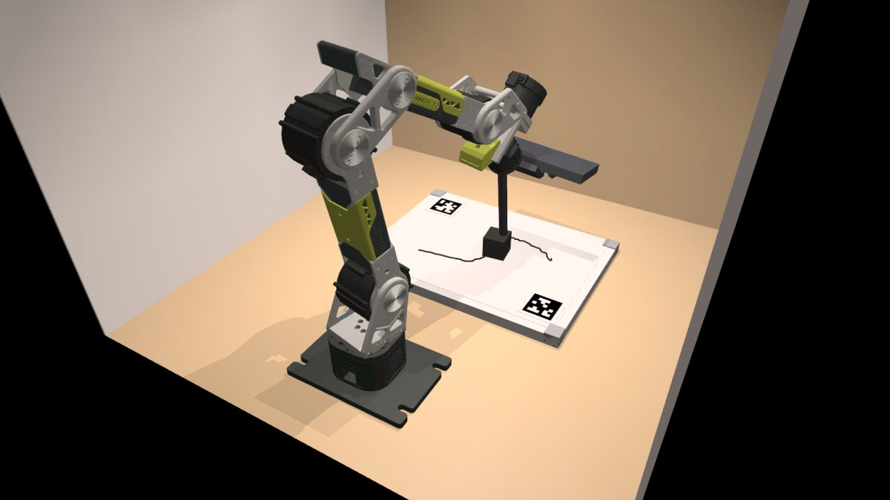
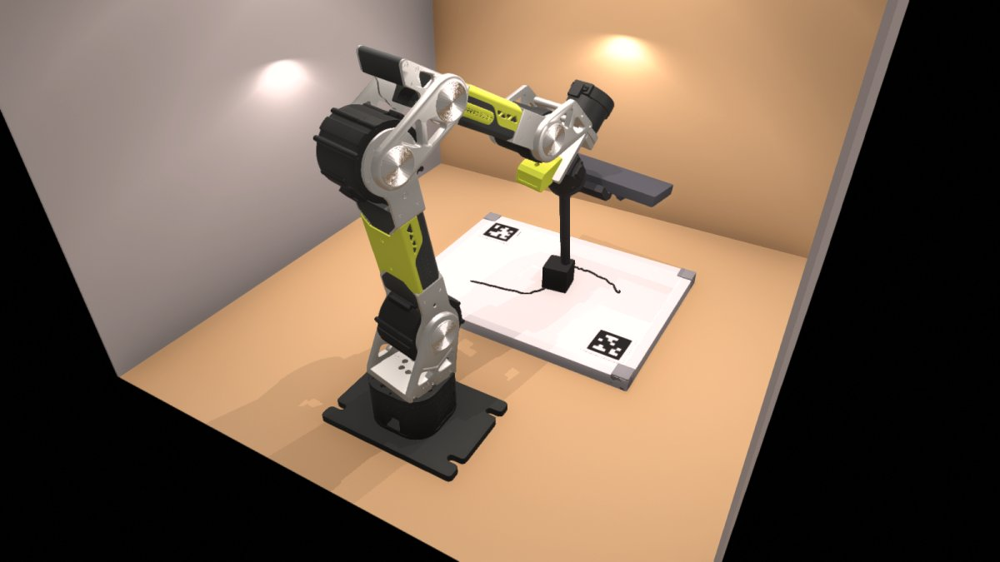

# 孪生场景

`sim/twin.py` 是这套设备的第二个、也更完整的场景。机械臂用的是厂家的网格，推杆用的是打印件的网格；摄影箱六面封闭；灯光和相机色调按真实相机拍到的画面调过。桌面上可以移动的物体写成一个列表，可以自己增减。第一版场景 [`sim/scene.py`](simulation.md) 保持原样，`robot/` 里的工具加 `--sim` 时用的仍然是第一版。





## 怎么用

```bash
uv sync --group robot --python 3.12
uv run python sim/fetch_arm_meshes.py                 # 只需一次：下载机械臂网格（约 30 MB）
uv run python sim/twin.py render --out /tmp/twin      # 两台相机的画面，物体在默认位置
uv run python sim/twin_view.py                        # 交互式查看（需要显示器）
```

在代码里：

```python
import sys

sys.path.insert(0, 'sim')
import twin

cfg = twin.load_config()
with twin.make_arm(cfg) as arm:  # 仿真后端上的 rebot_control.Arm，和第一版场景一样
    arm.backend.set_q(q)  # 或者 arm.enable(); arm.move_home(); ...
    image = twin.render(arm, 'top')  # 'wrist' 是工具上的相机；scale=0.5 渲染小图
    twin.set_object_pose(arm, 'cube', 0.35, 0.05, 30.0)  # 可移动物体的 x、y（m）和朝向（度）
```

渲染需要 GL 上下文。`MUJOCO_GL` 的设法和[第一版场景](simulation.md#gl-后端)一样：没有显示器的 Linux 用 `egl`，macOS 用 `glfw`。

### 机械臂网格

机械臂的网格不在本仓库里。`sim/fetch_arm_meshes.py` 从 [Seeed-Projects/reBot-DevArm](https://github.com/Seeed-Projects/reBot-DevArm) 的一个固定提交下载它们，连同许可证原文（CERN-OHL-W-2.0），并逐个文件对照 `sim/assets/meshes/b601_rs_official/SHA256SUMS` 校验。对不上的文件不会留下。

| 命令 | 作用 |
| --- | --- |
| `fetch_arm_meshes.py` | 把 18 个网格和许可证下载到 `sim/assets/meshes/b601_rs_official/`。 |
| `fetch_arm_meshes.py --from <克隆>` | 改为从那个仓库的本地克隆里复制。 |
| `fetch_arm_meshes.py --check` | 只校验已有的文件。 |

没有网格时，`twin.load_config()` 会停下，并指出缺的是哪个网格、该运行哪个脚本。这些网格只用来画，不参与碰撞。

### 查看器

`sim/twin_view.py` 打开 MuJoCo 的交互式查看器。默认隐藏箱子的正面（操作者那一侧，在机械臂背后）和顶，这样是从平时的方向往里看。

| 选项或按键 | 作用 |
| --- | --- |
| `--hide none` | 显示封闭的箱子。 |
| `--hide front,left` | 隐藏指定的面：`front`、`back`、`left`、`right`、`top`。 |
| F8、F9、F10、F11、F12 | 分别切换前、后、左、右、顶这几个面。 |
| Ctrl+Tab | 切到场景里的顶部相机或腕部相机。 |

隐藏某个面只影响这个窗口里的画面，`twin.render()` 画的永远是封闭的箱子。查看器没法加相机色调，所以改为把环境光调亮。查看器始终用经典渲染器。

## 文件

| 文件 | 内容 |
| --- | --- |
| `sim/twin.yaml` | 场景：固定部分（机械臂网格、箱子、地面、灯、相机内参和色调、Filament 设置）和物体列表（白板、方块）。每个数都注明是实测、从视频量的、调出来的还是暂估的。 |
| `calibration/tool_ip17pro_print.yaml` 里的 `sim:` 段 | 场景怎样画这个工具：网格、碰撞形状、手机、腕部相机的坐标系。控制库会忽略这一段。 |
| `sim/twin_registration.yaml` | 场景在用的相机和标记位置：顶部相机的位姿、腕部相机在法兰上的位姿、白板的白色区域和边框、标记在白板上的位置。 |
| `sim/twin.py` | 搭场景、渲染、投影、读取和设置物体位姿。 |
| `sim/twin_filament.py` | 可选的 Filament 渲染器。 |
| `sim/twin_view.py` | 查看器。 |
| `sim/fetch_arm_meshes.py`、`sim/assets/meshes/b601_rs_official/` | 机械臂网格的下载脚本，以及 `SOURCE.md` 和 `SHA256SUMS`。 |

坐标系和第一版场景一样，是机械臂坐标系。

## 建模了什么

- **机械臂：** 运动学和动力学来自控制库，外面套厂家没有降面的网格（18 个零件，约 61.7 万个三角面）。只有工具参与碰撞，形状按工具文件来：推杆、安装盘和手机。机械臂的连杆不参与碰撞。
- **物体：** 都是自由体。白板带着自己的质量和摩擦放在地面上，方块放在白板上。要加物体，就在 `sim/twin.yaml` 的列表里加一项。
- **摩擦：** 由表面决定。地面、白板的白色表面和工具有优先权：方块在白板上的摩擦取白板的 `surface_friction`，工具推方块的摩擦取 `base.tool_friction`。
- **箱子：** 边长 80 cm 的立方体，六面封闭：银白色的布，地面和背面是背景纸，机械臂背后是一块带开口的布，灯带下面是一层柔光布。只有地面参与碰撞。
- **相机：** 用真实的焦距和主点，没有镜头畸变。MuJoCo 渲染出的画面和投影公式相差 1 到 1.5 像素。
- **灯光和相机色调：** 两条灯带，几盏补光灯代替箱壁的反射光，再加环境光。MuJoCo 没有曝光模型，而手机是自动曝光的，所以每台相机有一个固定的色调（各颜色通道的增益和一个 gamma），由 `twin.render()` 加上；`raw=True` 时不加。

### Filament 渲染器

MuJoCo 4.0 带了第二个渲染器 Filament，是基于物理的。让相机画面用它来渲染：

```python
cfg = twin.load_config()
cfg['base']['renderer'] = 'filament'  # 或者在 sim/twin.yaml 里写 base.renderer: filament
with twin.make_arm(cfg) as arm:
    image = twin.render(arm, 'top', scale=0.5)
```

- 经典渲染器需要 `mujoco` 3.2 或更高版本；Filament 需要 4.0 或更高版本，版本不够时场景会停下并说明原因。`robot` 依赖组装的是 4.x。
- 用 Filament 时，场景里的材质多了金属度和粗糙度，灯改用坎德拉为单位并带软阴影，另有一个环境光代替箱子里的反射光。这些数值在 `sim/twin.yaml` 的 `base.filament` 里。
- 相机是同一组。两个渲染器的画面里，标记角点相差约 0.1 像素。
- 分割图始终由经典渲染器给出。

## 限制

- **调过的是外观，不是接触。** 除了 `sim/twin.yaml` 里标着“measured”的，摩擦和质量都是暂估值。在场景里推一下只能看个趋势。
- **颜色只在平均意义上对得上。** 灯光和色调是对着两台真实相机的少数几帧画面调的。真实画面里，同一块表面内部的明暗变化大得多：光照不均、布的皱褶、反光、自动曝光。白板上灯带的倒影、线缆、从开口看出去的景象都没有建模。
- **Filament 从外面看更好看，但并不更接近真实相机。** 和真实画面比颜色时，经典渲染器略接近一些。Filament 渲染一张图的时间大约是经典渲染器的两到四倍。
- **有些尺寸是暂估的：** 箱子的内部高度、正面开口的大小、白板的质量。白板的厚度没有量过：场景让白板的上表面落在机械臂测出的桌面高度上，厚度由此倒推。
- **`sim/twin_registration.yaml` 属于某一套设备。** 里面的数值是对着那套设备的录像拟合出来的，相机或标记挪动以后就过时了。文件里可以放不止一个顶部相机位姿，`default_session` 指明用哪一个。
- **拟合配准结果、测量 episode 起始状态的工具还没有放进本仓库。** 配准文件里只有拟合出来的数值。`twin.load_state()` 以及 `--episode`、`--replay` 两个选项要读 `data/derived/twin/<episode>/` 下的文件，而这些文件只有那些工具会写。没有文件时它们会停下，并说明缺的是什么。
- **CI 里不测渲染。** CI 里的测试不需要网格，也不需要 GL 上下文。渲染是在 macOS 上手工检查的（两个渲染器都试过），并和这个场景的源代码做了对比。

## 录制的数据

`twin.py` 到 `data/episodes/` 里找录好的 episode，`robot/episode.py` 也是往这里写的；起始状态则在 `data/derived/twin/` 里找。设置环境变量 `ASFINGER_DATA` 可以用别的目录代替 `data/`。这个变量只改变孪生场景去哪里读，录制工具有它们自己的 `--root` 选项。

## 换一根推杆

写一个新的工具文件 `calibration/tool_<名字>.yaml`，带上 `tcp`、`tip` 和 `sim:` 段（网格文件、`mount`、碰撞形状、手机、腕部相机的坐标系），再把 `sim/twin.yaml` 里的 `base.tool` 指向它。`sim/twin_registration.yaml` 里腕部相机的位姿会覆盖工具文件里的坐标系，所以换推杆以后要么删掉那一项，要么重新配准。
